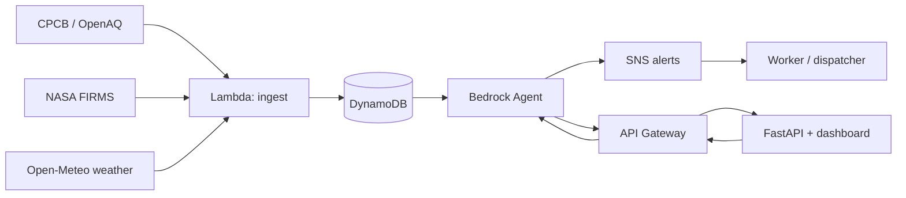

# 🛡️ Kavach — Environmental Safety Copilot for Delhi's Outdoor Workers

> Built for **Environmental Hacks**, Event 02 of the Bharat Builds Tour (WeMakeDevs × AWS), **Air track**.
>
> **Status: core engine built and tested locally (25 tests passing), submitted as a Build-track entry
> — no AWS account used, no deployed URL.** Everything below runs with zero AWS setup and zero API
> keys; every live data source falls back to realistic offline sample data. See `DECISIONS.md` for why
> it's built this way and `BLUEPRINT.md` for the full technical spec and status checklist.
>
> 🎥 **Demo video:** https://youtu.be/rEcifdrzgIw

## The problem

Delhi's delivery riders, traffic police, construction labourers and street vendors spend 8–10 hours
outside precisely when the city's AQI crosses 400+ (Oct–Nov stubble-burning season) and when heat
stress is dangerous. A citywide AQI number or a temperature reading doesn't tell any one of them what
*they personally* have breathed in, or when to stop, or which route costs them less. Kavach does.

## What it does

- **Pollution exposure dose** — turns ambient PM2.5 and how hard someone is working into an actual
  inhaled dose, shown as cigarette-equivalents, not a number nobody acts on.
- **"Take cover now" heat-stroke warning** — a WBGT-approximate heat-stress index from temperature,
  humidity and exertion level, with an automatic alert when it crosses a danger threshold.
- **Route comparison** — scores route options by cumulative heat + pollution exposure, not just
  distance, and shows the trade-off plainly (e.g. a few minutes longer for a much cleaner route).

An agent (Amazon Bedrock, via boto3's Converse API) explains the fused risk signals in plain language —
with a deterministic offline fallback so the safety alerts never depend on an AI being reachable.

**Future scope:** the route-comparison engine is designed to generalize beyond the fixed demo corridor —
it could plug into delivery platforms like Zomato/Swiggy to route riders around their lowest-exposure
path for a shift, or into Google Maps as a "healthiest route" layer alongside fastest/shortest, the way
Maps already offers eco-friendly routing. The underlying exposure-dose engine would also work as a
backend service these platforms could query directly, rather than a rider-facing app alone.

## How it works



Full architecture, data sources, and the exposure/heat-index math are in `BLUEPRINT.md`.

## Tech stack

- **Compute:** AWS Lambda (ingestion, risk calculation, route scoring) via Mangum, wrapping one FastAPI app
- **Data:** Amazon DynamoDB (schema defined, deploy-ready)
- **AI:** Amazon Bedrock (agent fusing heat + pollution + route signals), with a deterministic offline
  fallback when Bedrock isn't configured
- **API:** Amazon API Gateway (via AWS SAM)
- **Alerts:** Amazon SNS (topic defined, publish call pending — see `BLUEPRINT.md` status)
- **Infra as code:** AWS SAM (`template.yaml`) — Lambda, API Gateway, DynamoDB, SNS, all defined and
  ready for `sam deploy`, built and tested entirely on the no-AWS-account Build track path
- **Data sources:** CPCB/OpenAQ (live AQI), NASA FIRMS (stubble-burning fire detections), Open-Meteo
  (temperature/humidity) — each with a documented offline fallback

## Quick start

Requires Python 3.10+.

```bash
git clone https://github.com/<your-username>/kavach.git
cd kavach
python -m venv .venv && source .venv/bin/activate   # Windows: .venv\Scripts\activate
pip install -e ".[dev]"

pytest -q                       # 25 tests, all offline-safe
python -m kavach.cli --demo     # simulates a full shift for all 3 personas, no keys needed
uvicorn kavach.api:app --reload # open http://127.0.0.1:8000
```

Everything above works with **no API keys and no AWS account** — every data source and the
explanation agent fall back to realistic offline sample data (see `DECISIONS.md` #11). To use live
data and a real Bedrock explanation:

```bash
cp .env.example .env
# edit .env: add OPENAQ_API_KEY, FIRMS_MAP_KEY, and AWS credentials for Bedrock
```

## Deploy to AWS (optional — not used for this submission)

```bash
pip install aws-sam-cli
sam build && sam deploy --guided
```
Deploys the API (Lambda + HTTP API, via Mangum wrapping the same FastAPI app), the scheduled ingest
Lambda, a DynamoDB table, and an SNS topic. See `template.yaml`. This submission was built and tested
entirely on the Build track's no-AWS-account path, so this step was not run for the hackathon deadline.

## Who this is for

Three named personas used throughout the design, dashboard and demo video: **Rohan** (food-delivery
rider), **Constable Singh** (Delhi traffic police), **Mahesh** (construction labourer). See
`BLUEPRINT.md` section 4.

## Limitations (honest)

- **No AWS deployment for this submission** — built and tested entirely on the Build track's
  no-AWS-account path. `template.yaml` is written and ready, but `sam deploy` has not been run.
- The route-comparison feature uses a **fixed demo corridor** (3 real roads near DTU), not citywide
  live routing — a deliberate scope decision for a short build window, explained in `DECISIONS.md`.
- The heat-stress index is a **WBGT approximation** from temperature and humidity (NOAA heat-index
  regression + an exertion adjustment), not a full WBGT sensor reading — explained in `DECISIONS.md`.
- The explanation layer uses Amazon Bedrock when credentials are available; otherwise it falls back to
  a deterministic template so the safety logic never breaks — the dashboard labels which one produced
  a given explanation.
- This is a hackathon prototype relying on public data sources (CPCB/OpenAQ, NASA FIRMS), not a
  safety-certified product.

## Roadmap

Deploy to AWS, expand beyond the fixed corridor to full city routing, add more personas, add a
physical PM2.5 sensor for real hardware validation, and pilot with an actual rider fleet, delivery
platform, or municipal body.

## License

MIT
