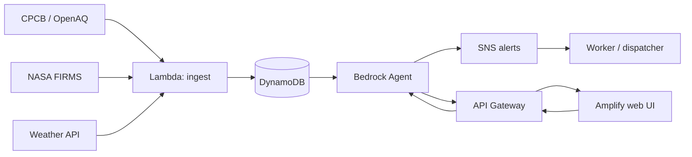

# 🛡️ Kavach — An Environmental Safety Copilot for Delhi's Outdoor Workers

> Built for **Environmental Hacks**, Event 02 of the Bharat Builds Tour (WeMakeDevs × AWS), Air track.
>
> **Status: core engine built and tested locally (25 tests passing); not yet deployed to AWS.**
> The risk engine, route comparison, simulation, API and dashboard all run today with real
> calculations and offline-safe fallbacks. What's left is deploying `template.yaml` to AWS, wiring a
> live Bedrock model, and recording the demo video. See `BLUEPRINT.md` section 15 for the live status
> checklist and `DECISIONS.md` for why it's built this way.

## The problem

Delhi's delivery riders, traffic police, construction labourers and street vendors spend 8–10 hours
outside precisely when the city's AQI crosses 400+ (Oct–Nov stubble-burning season) and when heat
stress is dangerous. A citywide AQI number or a temperature reading doesn't tell any one of them what
*they personally* have breathed in, or when to stop, or which route costs them less. Kavach does.

## What it does

- **Pollution exposure dose** — turns ambient PM2.5 and how hard someone is working into an actual
  inhaled dose, shown as cigarette-equivalents, not a number nobody acts on.
- **"Take cover now" heat-stroke warning** — a WBGT-approximate heat-stress index from temperature,
  humidity and exertion level, with the nearest shaded point when it crosses a danger threshold.
- **Route comparison** — scores route options by cumulative heat + pollution exposure, not just
  distance, and shows the trade-off plainly (e.g. 3 minutes longer for 120 fewer AQI-minutes).

An agent (Amazon Bedrock) fuses all three signals and decides when to alert, and explains why.

## How it works



Full architecture, data sources, and the exposure/heat-index math are in `BLUEPRINT.md`.

## Tech stack

- **Compute:** AWS Lambda (ingestion, risk calculation, route scoring)
- **Data:** Amazon DynamoDB
- **AI:** Amazon Bedrock (agent fusing heat + pollution + route signals)
- **API:** Amazon API Gateway
- **Alerts:** Amazon SNS
- **Frontend hosting:** AWS Amplify Hosting
- **Data sources:** CPCB/OpenAQ (live AQI), NASA FIRMS (stubble-burning fire detections), a weather API
  (temperature/humidity)

## Quick start

Requires Python 3.10+.

```bash
git clone https://github.com/<username>/kavach.git
cd kavach
python -m venv .venv && source .venv/bin/activate   # Windows: .venv\Scripts\activate
pip install -e ".[dev]"

pytest -q                       # 25 tests, all offline-safe
python -m kavach.cli --demo     # simulates a full shift for all 3 personas, no keys needed
uvicorn kavach.api:app --reload # open http://127.0.0.1:8000
```

Everything above works with **no API keys and no AWS account** — every data source and the
explanation agent fall back to realistic offline sample data (see `DECISIONS.md` #11). To use live
data and a real Bedrock explanation:

```bash
cp .env.example .env
# edit .env: add OPENAQ_API_KEY, FIRMS_MAP_KEY, and AWS credentials for Bedrock
```

## Deploy to AWS

```bash
pip install aws-sam-cli
sam build && sam deploy --guided
```
Deploys the API (Lambda + HTTP API, via Mangum wrapping the same FastAPI app), the scheduled ingest
Lambda, a DynamoDB table, and an SNS topic for alerts. See `template.yaml`.

## Live demo 🚧

- Deployed URL: _add after `sam deploy`_
- Demo video: _add once recorded_

## Who this is for

Three personas used throughout the design and demo: **Rohan** (food-delivery rider), **Constable
Singh** (Delhi traffic police), **Mahesh** (construction labourer). See `BLUEPRINT.md` section 4.

## Limitations (honest, as of planning stage)

- The route-comparison feature uses a **fixed demo corridor** (2–3 real roads), not citywide live
  routing — a deliberate scope decision for a 4-day build, explained in `DECISIONS.md`.
- The heat-stress index is a **WBGT approximation** from temperature and humidity, not a full WBGT
  sensor reading (globe/wet-bulb temperature) — explained in `DECISIONS.md`.
- Scheme/data accuracy depends on CPCB/OpenAQ and NASA FIRMS uptime; this is a hackathon prototype,
  not a safety-certified product.

## Roadmap

Expand beyond the fixed corridor to full city routing, add more personas, add a physical PM2.5 sensor
for real hardware validation, and pilot with an actual rider fleet or municipal body.

## License

MIT
